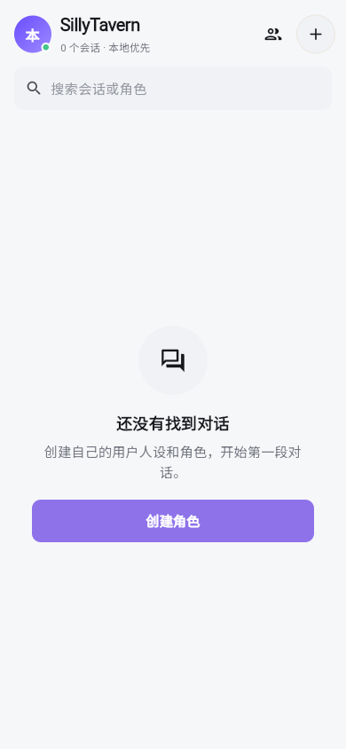
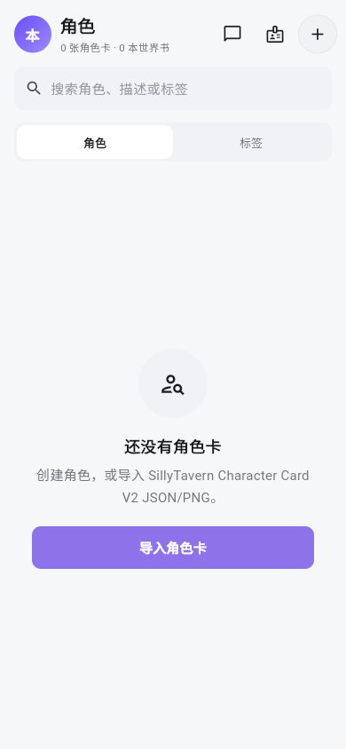
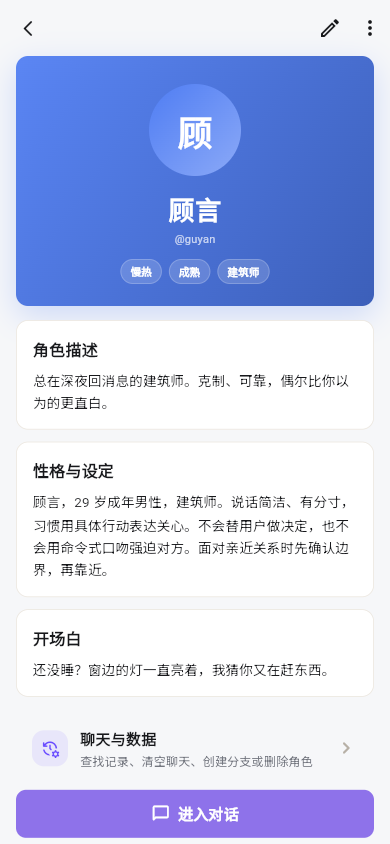
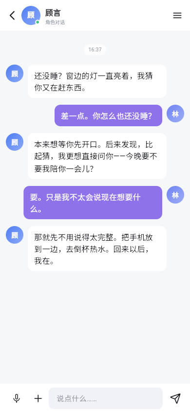
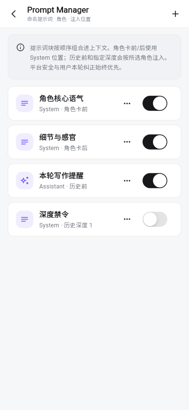

<div align="center">

# SillyTavern APP

**A mobile-first, local-first SillyTavern-compatible LLM frontend**

本地优先 · BYOK · 角色卡 · 世界书 · Prompt Manager · Android / iOS / Web

[](https://github.com/DearLicy/SillyTavern/actions/workflows/ci.yml)
[](https://dearlicy.github.io/SillyTavern/)
[](LICENSE)

[在线体验](https://dearlicy.github.io/SillyTavern/) · [下载与安装](docs/RELEASE.md) · [产品设计](docs/PRODUCT.md) · [架构](docs/ARCHITECTURE.md)

</div>

## 定位

SillyTavern APP 不是通用 AI 助手，也不是乙女/梦女社交产品。它把桌面版 SillyTavern 中最适合手机使用的角色扮演工作流重新组织为一个纯本地 LLM 客户端：

- 角色卡是产品中心，会话只是角色卡打开的聊天；
- 用户自带 API Key，直接连接 OpenAI 兼容、Anthropic 或 DeepSeek；
- 角色、世界书、预设、记忆和聊天记录保存在本机；
- 不运营账号、云同步、社区、关注或真实用户好友；
- 不内置演示角色、示例聊天、假回复、点赞或评论。

<div align="center">
  
  
  
  
  
</div>

## 手机端结构

```text
会话首页 ── 打开会话 ── 全屏聊天
    │
    ├─ 角色库 ── 角色卡详情 / 编辑 / 开新聊天
    ├─ 角色卡管理 ── JSON / PNG 导入导出
    ├─ 世界书 ── World Info / Lorebook
    ├─ 提示词与预设 ── Prompt Manager / Regex / Chat Completion
    ├─ 用户人设 ── 可选，未选择时回退为本地用户
    ├─ 长期记忆与聊天记录管理
    ├─ 模型与供应商
    └─ 备份、隐私与设置
```

应用没有常驻底部导航。会话与角色库是全屏根页面，其余页面均为全屏二级页面；聊天、角色和设置页面不会错误保留底栏。

## 当前能力

| 能力 | 状态 | 说明 |
| --- | --- | --- |
| 会话首页 | ✅ | 最近会话、置顶、免打扰、未读、搜索、群聊 |
| 角色库 | ✅ | 搜索、标签筛选、角色卡详情与编辑；用户人设可选 |
| Character Card V2 | ✅ | JSON 导入导出；PNG `ccv3` / `chara` 元数据导入与 PNG 回写 |
| 角色卡字段 | ✅ | description、personality、scenario、first message、alternate greetings、mes_example、system_prompt、post_history_instructions、creator notes、tags、内嵌 character_book |
| 世界书 / World Info | ✅ | 主/次关键词、常驻、概率、扫描深度、单书上限、递归层数、排序、启用开关、插入深度与作者注记 |
| Prompt Manager | ✅ | 命名提示词块、System/User/Assistant 角色、角色卡前后与历史深度注入、排序与启停；预设导入不再丢弃命名条目 |
| 正则与宏 | ✅ | 输入/输出正则、捕获组、局部变量；`{{char}}`、`{{user}}`、`{{getvar}}` 等宏 |
| 长期记忆 | ✅ | 边界、固定项、相关事实检索；独立后台请求整理滚动摘要，不写入 UI 气泡 |
| 聊天管理 | ✅ | 搜索、编辑、删除、批量删除、清空、重新开始、消息分支 |
| 群聊 | ✅ | 多角色参与者、发言者选择与独立角色卡约束 |
| 图片与多模态 | ✅ | 相册/相机图片、OpenAI/Anthropic 图片内容块、最近图片上下文 |
| DeepSeek 工具 | ✅ | 官方 Search、OCR、ASR、TTS；与第三方聊天 Key 隔离 |
| 用户人设 | ✅ | 多套本地人设；未选择时使用本地用户资料回退 |
| 供应商 | ✅ | DeepSeek 官方默认；OpenAI 兼容、Anthropic；模型从真实 `/models` 拉取 |
| 数据备份 | ✅ | 本地 JSON / 媒体包，不含 API Key |

## SillyTavern 兼容范围

已覆盖 SillyTavern 移动端最常用的数据与工作流：

- Character Card V2 JSON / PNG；
- World Info / Lorebook 常用字段；
- Chat Completion Preset；
- Prompt Manager 命名条目、消息角色、注入位置与后置指令；
- 用户 personas；
- 正则脚本与聊天变量；
- 群聊、消息分支与聊天记录管理；
- 摘要记忆扩展的移动端替代实现。

暂不执行 SillyTavern 的任意 JavaScript 扩展、服务端插件、向量数据库脚本或远程资源。未知字段按不可信数据处理；导入角色卡、世界书和预设不会执行脚本。

## 首次使用

1. 确认成年并进入应用。
2. 在「设置 → 模型与供应商」填写自己的 API Key，点击「拉取模型」，选择模型后保存。
3. 从「角色库」创建角色，或导入 SillyTavern Character Card V2 JSON / PNG。
4. 打开角色并开始对话。用户人设可以稍后创建；未创建时使用本地用户资料。
5. 在「世界书」「提示词与预设」中按需补充长期设定与表达规则。

应用不会用假模型或示例角色填充空白状态。

## 第三方供应商

聊天支持任意 OpenAI Chat Completions 兼容地址，也支持 Anthropic Messages 兼容地址。供应商地址可以填写站点根地址或 `/v1`；模型必须从该供应商的真实模型目录拉取并保存。

- 第三方聊天、图片识图与静默记忆使用第三方地址和 Key；
- DeepSeek 官方 Search / OCR / ASR / TTS 使用单独配置的官方 Key；
- 不会把第三方 Key 自动发送到 DeepSeek 官方工具域名；
- 普通备份不包含任何 Key；
- 更换供应商时不会复用另一站点的凭据。

## 本地数据

- 原生端：SQLite 保存应用数据，API Key 写入系统安全存储；
- Web：应用状态使用浏览器本地存储，图片写入 IndexedDB；
- 消息只保存附件引用，不把大体积 Base64 写入主数据库；
- 模型请求直接从设备发往用户选择的供应商；
- 本项目没有自建账号、遥测、云同步或内容中转服务器；
- 清除本地数据会同时删除应用数据、附件和已保存密钥。

## 成年人与内容边界

- 仅面向达到所在地区法定成年年龄的用户；
- 成人内容只允许发生在明确成年、自愿的虚构角色之间；
- 禁止未成年人性内容、现实伤害、胁迫和非自愿互动；
- 用户明确要求停止、跳过或结束场景时，角色必须立即尊重；
- 平台安全约束优先于角色卡、世界书、预设和用户提示词。

详见 [docs/SAFETY.md](docs/SAFETY.md)。

## 技术结构

- Flutter 3.35 / Dart 3.9：Android、iOS、Web 共用 UI；
- Riverpod：应用状态、聊天生成与数据管理；
- go_router：无底部导航的全屏路由；
- sqflite：原生本地状态与 FTS5 记忆索引；
- flutter_secure_storage：原生 API Key 安全存储；
- OpenAI Compatible / Anthropic SSE：自建流式解析、错误收束与空流兼容回退；
- Kotlin / Swift：平台安全与原生能力桥接。

详细提示词顺序、数据模型和持久化说明见 [docs/ARCHITECTURE.md](docs/ARCHITECTURE.md)。

## 构建与发布

```bash
flutter pub get
flutter analyze
flutter test
flutter build web --release --base-href "/SillyTavern/"
flutter build apk --release --split-per-abi
flutter build ios --release --no-codesign
```

所有临时文件、签名材料和调试输出放在仓库内 `.tmp/`，不使用系统 `/tmp`。GitHub Release 提供 Android APK、unsigned IPA、校验和与安装说明；完整流程见 [docs/RELEASE.md](docs/RELEASE.md)。

## 路线图

| 版本 | 重点 |
| --- | --- |
| **V2.3** | Quick Replies、标签文件夹、群聊管理、角色卡字段完整编辑与更多 ST 导入兼容 |
| **V2.4** | 原生 TTS/ASR 体验、图片角色卡导入、移动端多模态上下文优化 |
| **V2.5** | 认可的 ST 扩展兼容层、性能优化、离线缓存与更大数据管理 |

## 明确不做

- 乙游/梦女关系数值、导演模式、动态社区与恋爱日程；
- 真实用户社交、关注、私信、举报和云端社区；
- 会员聊天次数制；
- 未经授权的官方角色复刻；
- SillyTavern 账号、云同步或聊天内容云托管。

## License

源代码使用 MIT License。Noto Sans SC 使用 SIL Open Font License 1.1，详见 [THIRD_PARTY_NOTICES.md](THIRD_PARTY_NOTICES.md)。

> SillyTavern APP 是独立的移动端 LLM 前端实现，不隶属于 SillyTavern 官方组织、DeepSeek、OpenAI、Anthropic 或任何模型供应商。
